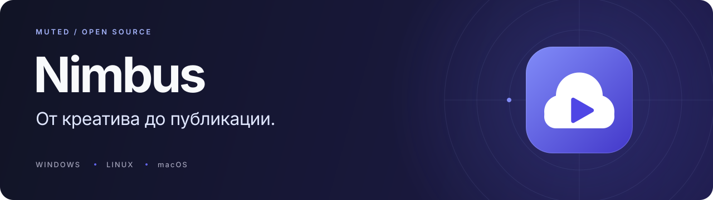
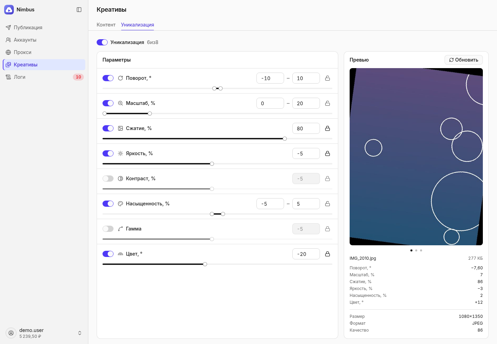
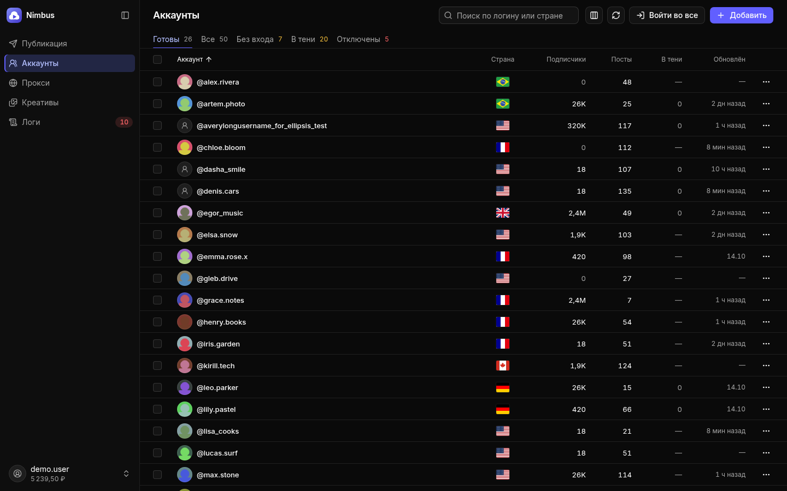
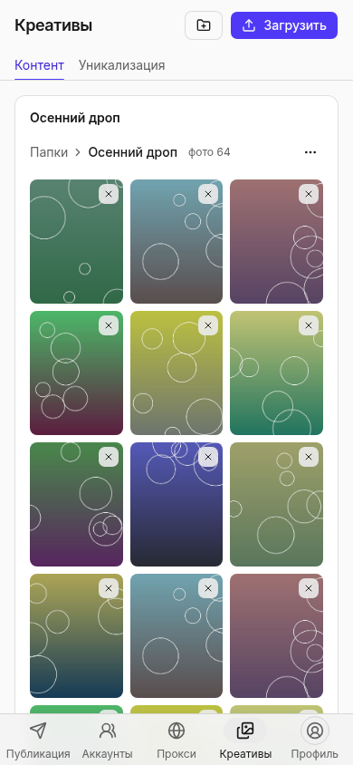

  

<h1 align="center">Nimbus</h1>

  Открытый клиент для аккаунтов TikTok, подготовки фото и видео и запуска публикаций. 
  На компьютере — в отдельном окне. На телефоне — в браузере по QR-коду.

  
  
  
  

  <a href="https://github.com/muted-team/nimbus/releases/latest"><strong>Скачать Nimbus</strong></a> ·
  <a href="ИНСТРУКЦИЯ.md">Инструкция</a> ·
  <a href="#features">Возможности</a> ·
  <a href="docs/development.md">Разработка</a> ·
  <a href="CHANGELOG.md">Что нового</a>

> **Перед началом.** Для входа в TikTok и публикации нужен ключ отдельного сервиса
> Nimbus API. Исходники этого репозитория — клиент под лицензией MIT; доступ к
> сервису в лицензию не входит. Обработка медиа выполняется на вашем компьютере.

  

Настоящий интерфейс приложения. Все данные на снимках вымышлены.

## От подготовки до результата

| Возможность | Что можно сделать |
| :--- | :--- |
| **Аккаунты** | Добавить логины с паролями или браузерные куки, обновить профили, отфильтровать и выбрать аккаунты для работы. |
| **Прокси** | Импортировать HTTP- и SOCKS-прокси, проверить соединение, настроить NoShadow и массово изменить выбранные строки. |
| **Креативы** | Собрать фото и видео в папки, загрузить файлы из браузера или выбрать папку в нативном окне. |
| **Уникализация** | Настроить поворот, масштаб, сжатие и цвет фотографии; посмотреть результат до публикации. |
| **Публикация** | Задать число постов, паузы и повтор кругами; проверить сводку, следить за прогрессом и результатами. |
| **Логи** | Разобраться в ходе работы и причинах ошибок, найти нужную запись через фильтры. |

Русский, английский и украинский интерфейс. Светлая, тёмная и системная темы.
Поиск команд через **Ctrl+K** (**⌘K** на macOS), навигация с клавиатуры и
адаптивный интерфейс для телефона.

## Начать работу

1. Откройте [последний выпуск](https://github.com/muted-team/nimbus/releases/latest)
   и скачайте ZIP для своей системы.
2. Распакуйте архив **целиком** в папку с правом записи и запустите Nimbus.
3. Откройте **Профиль** через аватар в меню и укажите ключ Nimbus API.
4. Добавьте аккаунты, прокси и креативы. В разделе **Публикация** проверьте
   сводку и запустите работу.

| Система | Как узнать свой архив | Что запустить |
| :--- | :--- | :--- |
| Windows x64 | `nimbus-…-win32-AMD64.zip` | `Nimbus.exe` |
| Linux x64 | `nimbus-…-linux-x86_64.zip` | `Nimbus` |
| macOS · Apple Silicon | `nimbus-…-darwin-arm64.zip` | `Nimbus.app` |
| macOS · Intel | `nimbus-…-darwin-x86_64.zip` | `Nimbus.app` |

Python и Node.js для готовых пакетов не нужны. На Windows для окна нужен
Edge WebView2; если он отсутствует, см. [помощь с запуском](ИНСТРУКЦИЯ.md#troubleshooting).

**Первый запуск, импорт аккаунтов, работа с телефона и обновление** —
в [полной инструкции](ИНСТРУКЦИЯ.md).

## Интерфейс под вашу задачу

  

Аккаунты: статусы, фильтры и массовые действия в тёмной теме.

<strong>Посмотреть интерфейс на телефоне</strong>

  

Телефон подключается к программе в той же локальной сети. Задайте пароль,
включите доступ в настройках и отсканируйте QR-код. Программа на компьютере
должна оставаться открытой. [Пошаговое подключение →](ИНСТРУКЦИЯ.md#phone)

## Как устроен Nimbus

**На вашем компьютере** работают интерфейс, библиотека медиа, обработка
фотографий и хранение настроек. **Отдельный Nimbus API** выполняет вход в
TikTok, подпись запросов и публикацию. Для этих действий клиент передаёт
сервису необходимые данные аккаунта и контент; локальное хранение не означает
полностью автономную работу.

Чистый клон не содержит аккаунтов, сессий и ключей API. Для разработки
интерфейса есть стенд с вымышленными данными — без ключа и обращений к TikTok.
Подробнее: [архитектура и данные](docs/architecture.md).

## Для разработчиков

Клиент написан на **Python**, нативное окно — **pywebview**. Интерфейс —
**React 19, TypeScript, Vite и Tailwind CSS 4**, компоненты — **shadcn/ui
на Base UI**.

Для запуска из исходников нужны **Python 3.14**, **Node.js 24** и системный
WebView. Сборки проверяются на Windows, Linux, macOS Intel и Apple Silicon.

| Документ | С чего начать |
| :--- | :--- |
| [Руководство разработчика](docs/development.md) | Окружение, запуск, стенд, проверки и сборка. |
| [Архитектура](docs/architecture.md) | Границы клиента и сервиса, структура кода и хранение данных. |
| [Участие в проекте](CONTRIBUTING.md) | Как сообщить об ошибке и подготовить pull request. |
| [Выпуск версии](docs/releasing.md) | Проверки, заметки, тег и четыре готовых пакета. |
| [Устройство интерфейса](web/README.md) | Компоненты, темы, тексты и правила работы с UI. |

## Обратная связь

Нашли ошибку или хотите предложить улучшение? [Создайте issue](https://github.com/muted-team/nimbus/issues/new/choose)
с описанием ситуации и ожидаемого результата. Об уязвимостях сообщайте
приватно по [правилам безопасности](SECURITY.md).

Nimbus распространяется под [MIT](LICENSE). Лицензии зависимостей перечислены
в [сторонних компонентах](THIRD_PARTY_NOTICES.md).

Muted · Nimbus

