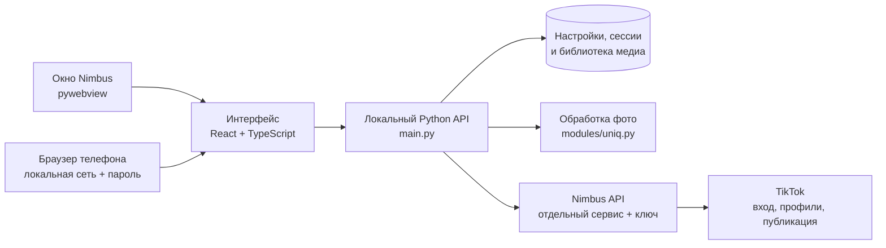

# Архитектура Nimbus

[← На главную](../README.md) · [Разработка](development.md) · [Безопасность](../SECURITY.md)

Nimbus состоит из открытого клиента и отдельного сервиса Nimbus API.
Граница между ними позволяет разрабатывать интерфейс и обработку медиа
без приватного кода сервиса.

## Общая схема



Нативное окно и браузер используют один интерфейс и HTTP API. По умолчанию
локальный сервер доступен только с компьютера. Включение доступа с телефона
открывает дополнительный сетевой вход с проверкой пароля; перезапуск
программы для этого не нужен.

## Ответственность частей

| Часть | Что делает |
| :--- | :--- |
| **React-интерфейс** | Формы, таблицы, темы и языки, навигация, просмотр состояния и результатов. |
| **Python-клиент** | Локальные настройки, аккаунты, файлы, подготовка медиа, управление запусками и запросами к сервису. |
| **pywebview** | Отдельное окно приложения и системные диалоги выбора файлов и папок. |
| **Nimbus API** | Вход в TikTok, подписи запросов, операции с профилями и публикациями. Не входит в этот репозиторий. |
| **Стенд интерфейса** | Подменяет API вымышленными ответами для разработки и снимков экрана. |

MIT распространяется на открытый клиент. Доступ к Nimbus API требует
отдельного ключа и не предоставляется вместе с исходниками.

## Карта репозитория

```text
nimbus/
├── app.py                    # запуск сервера и нативного окна
├── main.py                   # локальный HTTP API и выдача интерфейса
├── build.py                  # сборка Nuitka и упаковка ZIP
├── modules/                  # логика открытого клиента
├── web/
│   ├── src/app/              # навигация, маршруты, тема и вход
│   ├── src/api/              # запросы, типы и кэш данных
│   ├── src/features/         # экраны и их состояние
│   ├── src/components/       # общие компоненты
│   └── public/               # значок, тема и статические ресурсы
├── dev/_ui_mock.py           # стенд с вымышленными данными
├── tests/                    # Python-проверки
├── tools/                    # проверки дерева, пакетов и нативного окна
├── docs/                     # руководства и изображения документации
└── .github/workflows/        # проверки и выпуск четырёх пакетов
```

`ui/`, `web/dist/`, `build/` и `dist/` создаются при сборке и не входят
в исходники. Сервер приложения читает **`ui/`**; результат обычного
`npm run build` в `web/dist/` предназначен для отдельного просмотра.

### Основные модули клиента

| Модули | Назначение |
| :--- | :--- |
| `accounts.py`, `profiles.py`, `client_session.py` | Локальные аккаунты, данные профилей и состояние сессий. |
| `proxies.py`, `proxy_pool.py` | Форматы прокси, проверка и выбор соединения. |
| `photo_source.py`, `media_info.py`, `uniq.py` | Поиск медиа, сведения о файлах и обработка фотографий. |
| `campaign.py`, `batch_publish.py` | Запуск, состояние и координация публикаций. |
| `cloud.py`, `remote.py` | Контракты запросов и транспорт к Nimbus API. |
| `config.py`, `db.py`, `paths.py` | Настройки, база данных и изолируемые пути хранения. |
| `auth.py`, `eventlog.py` | Пароль интерфейса и журнал событий. |
| `brand.py`, `changelog.py` | Название продукта и история версий. |

Подробнее об организации интерфейса — в [web/README.md](../web/README.md).

<a id="data"></a>

## Данные и граница сервиса

Клиент хранит настройки, аккаунты, сохранённые сессии, базу данных и медиа
на компьютере пользователя. При запуске из исходников это корень проекта;
в сборке — каталог исполняемого файла. Список файлов и перенос между
версиями описаны в [руководстве пользователя](../ИНСТРУКЦИЯ.md#data).

Локальные файлы могут содержать ключ API, пароли аккаунтов и куки.
Их исключает `.gitignore`; `tools/check_public_tree.py` дополнительно
проверяет публикуемое дерево на пользовательские данные, приватные модули
сервиса и известные форматы ключей.

Для операций TikTok клиент отправляет в Nimbus API данные, необходимые
для выбранного действия: например, данные входа или сессии и контент
для публикации. Фото обрабатываются локально, но публикация требует
передачи подготовленных файлов сервису. Клиент не является полностью
автономным приложением.

В репозитории нет приватного сервиса, его служебных ключей и кода подписей.
В тестах и примерах используются синтетические аккаунты и ответы;
реальные данные не должны попадать в снимки, фикстуры или отчёты CI.

## Изменения на границе API

Сохраняйте запуск из чистого клона без приватных модулей. Если новая
возможность требует поддержки сервера, проверяйте совместимость до действия
и показывайте понятную ошибку при неподдерживаемом контракте.

Сетевой сбой после отправки запроса не доказывает, что действие не выполнено.
Повтор публикации может создать дубликат; транспорт различает ошибки до
отправки и ошибки с неизвестным результатом. При изменении повторов запросов
проверяйте эту границу отдельно.
